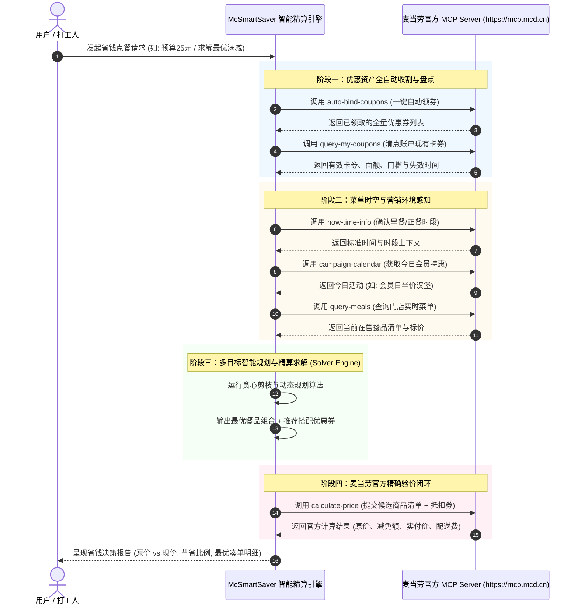

# 麦当劳 MCP 服务集成与架构技术文档 (MCP_INTEGRATION.md)

本项目 **麦门极致省钱精算管家 (McSmartSaver)** 深度集成麦当劳中国官方推出的 Model Context Protocol（MCP）开放服务，构建面向中国大陆地区消费者的智能餐饮省钱决策系统。

---

## 1. 麦当劳 MCP 服务接入规范

- **服务端接入地址**：`https://mcp.mcd.cn`
- **传输协议**：`Streamable HTTP`
- **鉴权方式**：`Authorization: Bearer <MCD_MCP_TOKEN>`
- **官方开放平台**：[https://open.mcd.cn/mcp](https://open.mcd.cn/mcp)
- **限流指标**：600 请求/分钟/Token

---

## 2. 实际调用的官方 MCP 工具列表

本项目实际接入并编排了麦当劳 MCP 提供的 8 项核心 Tool 能力：

| Tool 标识符 | 工具中文名称 | 在本项目中的作用与业务逻辑 |
|---|---|---|
| `auto-bind-coupons` | 麦麦省一键领券 | **资产初始化入口**：在精算前自动触发领取麦麦省全部可用优惠券，无需指定 couponId，确保用户账户拥有当下最全的折扣资产。 |
| `query-my-coupons` | 我的优惠券查询 | **可用资产盘点**：查询当前用户账户下的全部优惠券，包括满减券、单品折扣券、特惠套餐券及其生效/失效时间戳。 |
| `query-store-coupons` | 当前门店可用优惠券 | **门店可用性过滤**：校验卡券在目标餐厅的可用性，排除因门店类型、时段或库存限制不可用的券。 |
| `query-meals` | 在售餐品列表查询 | **供给底表检索**：获取目标餐厅实时在售的常规餐品、随心配、套餐及单品编码、原价与分类标签。 |
| `query-meal-detail` | 餐品详情查询 | **套餐拆解与组合**：查询“1+1 随心配”或特定套餐的可选配料、替换选项，支持灵活组单。 |
| `calculate-price` | 商品价格计算 | **官方验价闭环**：将算法求解推荐的餐品清单与优惠券组合上送麦当劳官方服务器计算，获取官方认可的优惠金额、配送费及应付实价。 |
| `campaign-calendar` | 营销活动日历查询 | **活动协同雷达**：获取当月与当日的麦麦营销活动（如会员日特惠、半价单品等），作为精算推荐的高优先级加权特征。 |
| `now-time-info` | 获取当前时间信息 | **时段与有效期校验**：精确匹配当前点餐时段（早餐/正餐/夜宵）及优惠券有效时段。 |

---

## 3. 核心调用流程与时序架构

系统的核心调用流转包括 **“优惠资产捕获 → 菜单与活动感知 → 约束满足求解 → 官方接口验价”** 四个阶段：

---

## 4. 业务价值与创新亮点

1. **消除“假优惠，真破费”陷阱**：
   传统消费者往往为了凑够满减门槛盲目加购高溢价单品。本项目求解器专门设立“单位卡路里成本 / 单位蛋白质成本”评估函数，以最低额外支出达到满减门槛。
2. **零遗漏资产复用**：
   利用 `auto-bind-coupons` 在会话开始时将平台分散赠券一键同步入库，配合临期预警，杜绝消费者的优惠券过期浪费。
3. **官方验价闭环**：
   避免本地纯算与麦当劳官方收银台规则（如特定券不能与随心配叠加、配送费起送价等）的不一致，通过 `calculate-price` 达成 100% 数据一致性。
4. **平滑降级设计 (Graceful Fallback)**：
   系统设计了本地仿真与离线回退机制，在缺少有效 Token 时提供拟真环境，保证代码的健壮性与可审计性。
